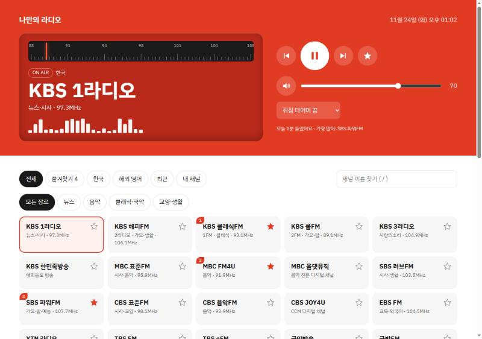

# 나만의 라디오 (My Radio)

한국 주요 라디오와 해외 영어권 라디오를 한 화면에서 누르면 바로 듣는 설치형 웹앱(PWA)입니다.

## 채널

- **한국 (21)**: KBS 1라디오·해피FM·클래식FM·쿨FM·3라디오·한민족방송, MBC 표준FM·FM4U·올댓뮤직, SBS 러브FM·파워FM, CBS 표준FM·음악FM·JOY4U, EBS FM, YTN 라디오, TBS FM·eFM, 국악방송, 국방FM, Arirang Radio
- **해외 영어권 (19)**: BBC World Service, BBC Radio 1·2·3·4·6 Music, NPR, WNYC, CNN, LBC, Times Radio, KEXP, Classic FM, WQXR, Heart London, Capital FM, Radio Paradise(2), AFN The Eagle
- **전 세계 검색**: radio-browser.info의 3만여 방송을 이름·장르로 찾아 듣고 내 채널에 추가

## 기능

- 채널 카드 한 번 누르면 바로 재생, 볼륨 슬라이더(마우스 휠 가능)·음소거
- 즐겨찾기(★)와 1–9 숫자키로 바로 듣기, 최근 들은 채널, 장르 필터, 채널 이름 찾기
- 취침 타이머(마지막 30초 서서히 작아짐), 라디오 알람(작게 켜서 천천히 키움)
- 끊기면 자동 재연결, 키보드·미디어 키·윈도우 볼륨 팝업 조작
- 오늘 들은 시간과 가장 많이 들은 채널 표시
- 직접 스트림 주소 추가(내 채널 카드는 오른쪽 클릭으로 삭제)
- PWA: PC·폰 홈 화면에 앱으로 설치, 화면은 오프라인에서도 열림

## 실행

**웹 주소로 (폰·PC):** GitHub Pages 주소를 열고 주소창의 설치 아이콘 또는 화면의 "앱으로 설치"를 누릅니다.
iPhone은 Safari 공유 버튼 → "홈 화면에 추가".

**PC에서 MBC까지 듣기:** 폴더의 `라디오 켜기.bat`을 더블클릭하면 `http://localhost:8787`로 열립니다.
MBC는 방송 주소를 브라우저에서 직접 받아올 수 없게 막아 두어서, 이 작은 로컬 서버(`server.ps1`)를 거칠 때만 나옵니다.
여기서도 "앱으로 설치"를 누르면 MBC가 되는 PC용 앱이 따로 설치됩니다(이때는 `라디오 켜기`가 켜져 있어야 합니다).

## 파일

| 파일 | 역할 |
| --- | --- |
| `index.html` | 앱 전체(화면·채널 목록·재생 로직) |
| `manifest.webmanifest`, `sw.js`, `icons/` | PWA 설치 정보, 오프라인 캐시, 앱 아이콘 |
| `server.ps1`, `라디오 켜기.bat` | PC용 로컬 실행기(MBC 주소 풀기) |

방송 스트림의 권리는 각 방송사에 있으며, 이 앱은 방송사가 공개한 웹 재생 주소를 이어 줄 뿐입니다. 방송사가 주소를 바꾸면 일부 채널이 안 나올 수 있습니다.
